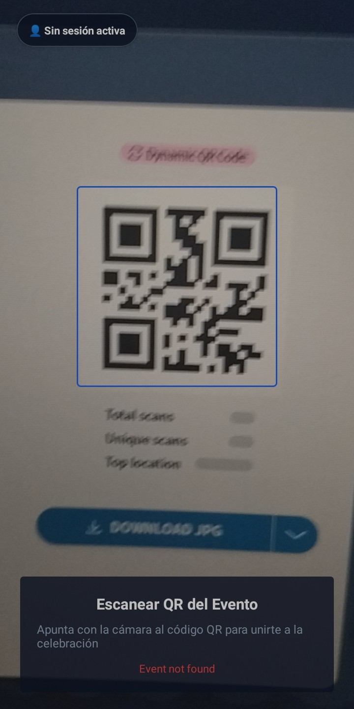
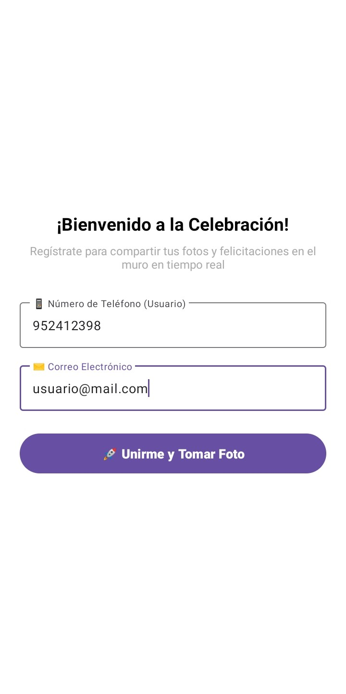
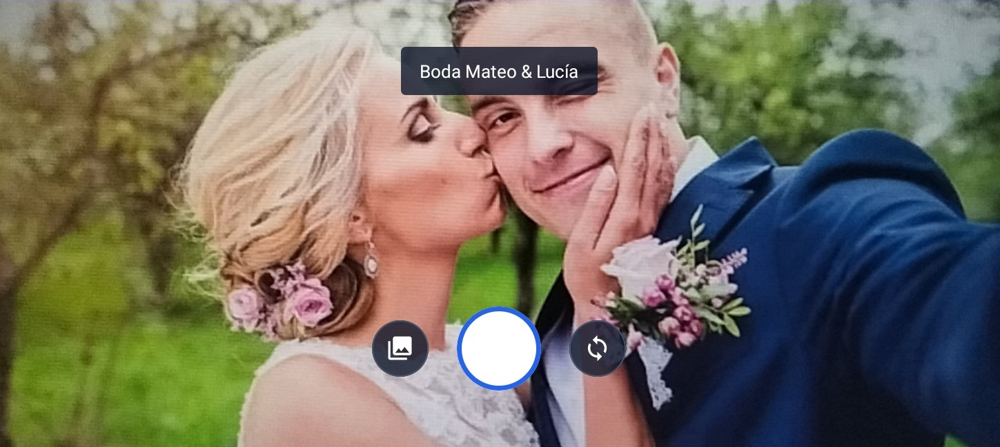
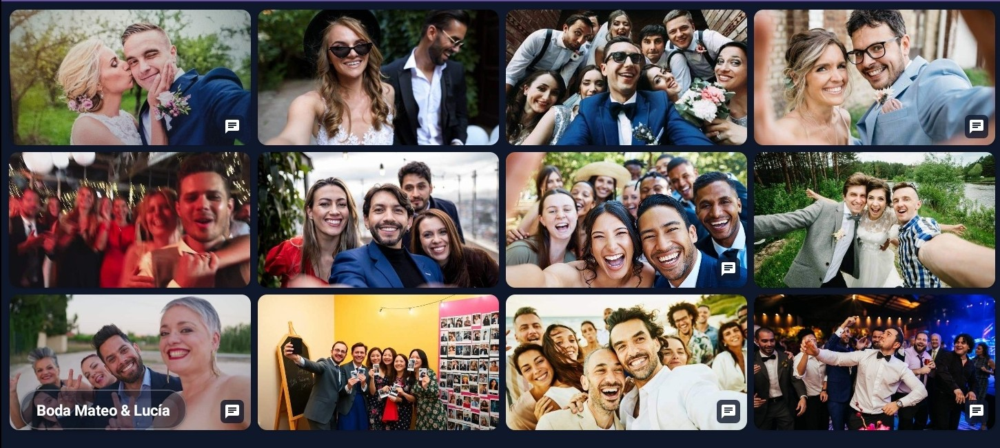

# Muro de Fotos Interactivo y Álbum en Tiempo Real para Eventos

[](https://developer.android.com)
[](https://www.java.com)
[](https://firebase.google.com)
[](https://developer.android.com/guide/components/fragments)

Una aplicación móvil nativa en Android diseñada para asistentes a eventos (bodas, graduaciones, fiestas corporativas). Los invitados escanean un código QR de evento, se registran con su número de teléfono, capturan o eligen fotos en formato panorámico 16:9 con mensajes dedicatorios y las publican en vivo en un collage compartido de 12 fotos a pantalla completa sin scroll.

---

## 📱 Interfaz de Usuario y Capturas de Pantalla

| 1. Escáner QR de Evento | 2. Registro de Asistente | 3. Cámara Panorámica |
| :---: | :---: | :---: |
|  |  |  |
| Escaneo QR con CameraX y MLKit, indicador de sesión de usuario y botón de cierre de sesión. | Registro sin contraseña mediante teléfono y correo con recuperación de cuenta. | Visor 16:9 horizontal, cambio de cámara (🔁) y selector de galería. |

| 4. Revisión y Dedicatoria | 5. Muro de Fotos Interactivo |
| :---: | :---: |
|  |  |
| Logotipo oficial del evento, vista previa y mensaje dedicatorio de hasta 200 caracteres. | Mosaico panorámico 3x4 (12 fotos), animación de traslado al publicar, giros 3D y visor modal. |

---

## 🌟 Características Principales

### 1. Enlaces Inteligentes y Deep Links por QR
- Intercepta enlaces QR con parámetros dinámicos (`?eventId=boda_demo`) mediante links de GitHub Releases o servidores Web.
- En celulares sin la app instalada inicia la descarga directa del APK; en celulares con la app instalada abre la aplicación directamente en el evento.

### 2. Autenticación y Reutilización de Cuenta Sin Contraseña
- Utiliza el número de teléfono como identificador único de usuario.
- Consulta el nodo `/users` en Firebase Realtime Database antes de guardar, reutilizando cuentas existentes sin duplicar registros.

### 3. Cámara Panorámica CameraX y Selector de Galería Seguro
- Bloquea la orientación a **Horizontal (Landscape)** para capturar fotos panorámicas en formato 16:9.
- Incluye alternador de cámara frontal/trasera (`ic_switch_camera` 🔁) y selector de fototeca nativo.
- Optimiza imágenes de la galería en hilos secundarios a 1024x768 px para prevenir fallos de memoria (`OutOfMemoryError`).

### 4. Muro de Fotos 3x4 a Pantalla Completa (Sin Scroll)
- Muestra 12 fotos horizontales (proporción 16:9) distribuidas en 3 filas y 4 columnas ocupando el 100% de la pantalla.
- Reemplaza la barra superior tradicional con una marca de agua flotante del evento en la esquina inferior izquierda.

### 5. Animación de Entrada en Vivo y Resplandor Dorado
- La foto recién publicada se muestra en un visor destacado en el centro de la pantalla.
- Calcula automáticamente las coordenadas de la primera celda `[0,0]` y realiza una animación suave de encogimiento y traslado (`Scale + Translate`).
- Al encajar en la celda `[0,0]`, desplaza las fotos anteriores e inicia un resplandor de borde dorado (`#FFD700`) durante 3 segundos.

### 6. Rotación 3D de Tarjetas para MÁS de 12 Fotos
- Cuando el evento supera las 12 fotos, un temporizador de 5 segundos realiza volteos 3D aleatorios (`rotationY`) en las casillas.
- Revela fotos antiguas del catálogo del evento manteniendo la primera celda `[0,0]` **protegida e intacta** con la foto más reciente.

### 7. Visor Modal de Fotos y Dedicatoria Desplazable
- Las tarjetas con mensaje incluyen un distintivo `💬` (`ivMessageIndicator`) en la esquina inferior.
- Hacer clic en cualquier foto abre un visor modal centrado sobre un fondo oscuro.
- Si la foto tiene dedicatoria, se muestra en una tarjeta inferior deslizable (`ScrollView`). Tocar fuera de la foto cierra el visor.

---

## 🛠️ Stack Tecnológico y Arquitectura

- **Lenguaje:** Java 17 (Nativo)
- **Interfaz y Diseños:** Material Design 3, ViewBinding, ConstraintLayout, RecyclerView, `GridLayoutManager`
- **Cámara y Escáner QR:** Android CameraX API (`camera-core`, `camera-camera2`, `camera-lifecycle`, `camera-view`), Google MLKit Barcode Scanning
- **Backend y Base de Datos:** Firebase Realtime Database, Firebase Authentication (Autenticación Anónima)
- **Procesamiento de Imagen:** Hilos secundarios de ejecución (`ExecutorService`), escalado de mapas de bits, compresión JPEG y codificación Base64

---

## 🗄️ Esquema de la Base de Datos (Firebase Realtime Database)

```json
{
  "events": {
    "boda_demo": {
      "id": "boda_demo",
      "name": "Boda Mateo & Lucía",
      "eventType": "boda",
      "eventCode": "BODA123",
      "active": true,
      "logoBase64": "",
      "createdAt": 1728240000000
    }
  },
  "users": {
    "UID_12345": {
      "id": "UID_12345",
      "phoneNumber": "+51987654321",
      "email": "usuario@ejemplo.com",
      "createdAt": 1728240000000
    }
  },
  "posts": {
    "-O123456789ABC": {
      "id": "-O123456789ABC",
      "eventId": "boda_demo",
      "userId": "UID_12345",
      "imageBase64": "/9j/4AAQSkZJRg...",
      "message": "¡Muchas felicidades a los novios!",
      "createdAt": 1728240000000,
      "deviceInfo": null
    }
  }
}
```

---

## 🚀 Compilación e Instalación

### Requisitos Previos
- Android Studio Ladybug (2024.2.1+) o posterior.
- JDK 17 configurado en Android Studio.
- Dispositivo físico Android o emulador con Android 7.0 (API nivel 24) o superior.

### Pasos para Ejecutar
1. Clonar el repositorio:
   ```bash
   git clone https://github.com/DylanRCA/AppCollageFotosSNT.git
   ```
2. Abrir el proyecto en Android Studio.
3. Asegurarse de que el archivo `google-services.json` esté ubicado dentro de la carpeta `app/`.
4. Sincronizar Gradle y ejecutar en tu dispositivo:
   ```bash
   ./gradlew assembleDebug
   ```

---

## 📄 Licencia
Proyecto académico desarrollado para la asignatura de Desarrollo de Aplicaciones Móviles.
